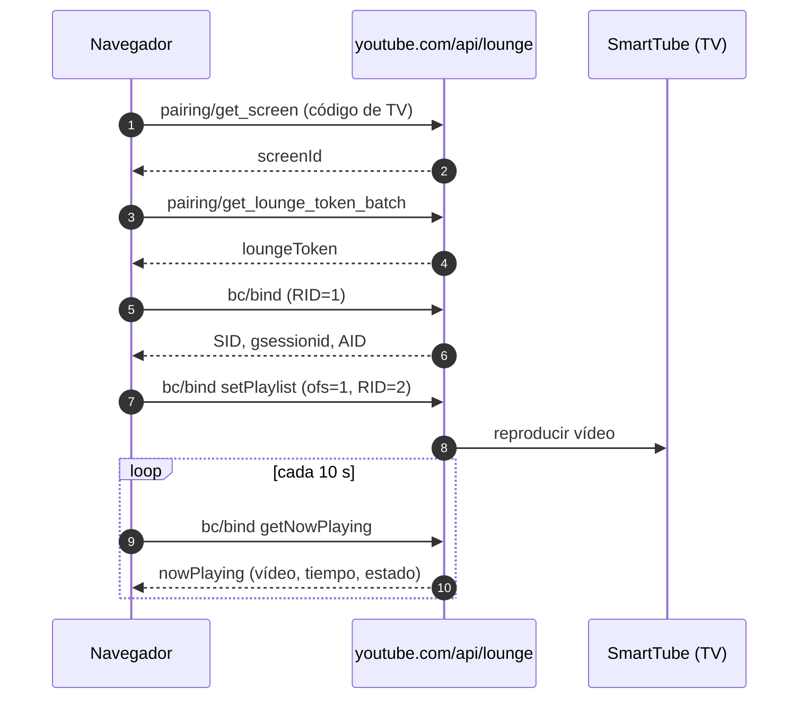

<p align="center">
  
</p>

<h1 align="center">Enviar a SmartTube</h1>

<p align="center">
  Reproduce en la TV el vídeo de YouTube que estás viendo, con <b>SmartTube</b> — un clic, sin cuenta y sin duplicar pantalla.
</p>

<p align="center">
  
  
  
</p>

<p align="center">
  <a href="README.md">🇬🇧 English</a> ·
  <a href="README.tr.md">🇹🇷 Türkçe</a> ·
  <a href="README.es.md">🇪🇸 Español</a>
</p>

---

Una pequeña extensión de navegador (y userscript) que envía el vídeo actual de YouTube a
[SmartTube](https://github.com/yuliskov/SmartTube) en un Android TV. Usa el mismo mecanismo que la función
"YouTube → Enviar a la TV" de la app móvil, pero **no duplica la pantalla**: el vídeo se reproduce de forma
nativa dentro de SmartTube, sin anuncios y con su propio reproductor.

- **Sin cuenta de Google/YouTube** — ambos lados pueden estar desconectados.
- **Sin YouTube Premium.**
- **No hace falta soporte de Cast/Chromecast** — funciona en navegadores como Helium.
- **Sin servidores de terceros** — solo se contacta con `youtube.com` y nunca se envían cookies.

> Probado con Helium en macOS y un Google TV Streamer con SmartTube.
> Proyecto no oficial; no está afiliado a YouTube, Google ni SmartTube.

## Características

- 📺 **Botón dentro del reproductor** — junto a CC / ajustes / pantalla completa, no un flotante en la esquina.
- ▶️ **Un clic o `Alt + S`** — el vídeo empieza en la TV y el reproductor local se pausa.
- 🟦 **Barra de emisión estilo Cast** — miniatura, título, estado en vivo, progreso, pausa/reanudar, siguiente, detener.
- ♻️ **Sobrevive a las recargas** — la barra vuelve tras recargar la página o reiniciar el navegador.
- 🌍 **Interfaz en turco / inglés / español**, elegida automáticamente según el idioma del sistema.
- 🔒 **Privacidad ante todo** — sin analíticas, sin seguimiento, sin cookies, permisos mínimos.

## Instalación

### Opción A — Extensión (recomendada, menor consumo de memoria)

1. Descarga este repositorio (**Code → Download ZIP**) y descomprímelo.
2. Abre `chrome://extensions` y activa el **Modo de desarrollador**.
3. Pulsa **Cargar descomprimida** y selecciona la carpeta `extension`.
4. Abre cualquier vídeo de YouTube — el botón 📺 aparece en la barra de controles del reproductor.

Para actualizar: sustituye los archivos y pulsa el icono **Recargar** de la tarjeta de la extensión.

> Chrome puede avisar sobre extensiones en modo desarrollador al arrancar. Déjalo activado; la extensión
> es local y no necesita la tienda.

### Opción B — Userscript (Tampermonkey / Violentmonkey)

1. Instala [Tampermonkey](https://www.tampermonkey.net/) o Violentmonkey.
2. Abre [`smarttube-sender.user.js`](https://raw.githubusercontent.com/chngrkvc/smarttube-tv-sender/main/smarttube-sender.user.js) — el gestor de scripts ofrece instalarlo.
   (Alternativa manual: panel → **+** → sustituye la plantilla por el contenido → guarda.)
3. Abre un vídeo de YouTube. El script se actualiza solo desde este repositorio.

> No ejecutes las dos versiones a la vez: aparecerían dos botones.

## Emparejar una vez

1. Abre **SmartTube** en la TV.
2. Ve a **Ajustes → Remote control → Add device** y apunta el código que aparece.
   - Comprueba que el interruptor **Remote control** esté activado.
   - En Android 10+ la app puede pedir permiso de superposición; concédelo.
3. Pulsa 📺 en el navegador, escribe el código y pulsa **Conectar**.

El código se guarda localmente y solo se pide una vez.

## Uso

| Acción | Cómo |
| --- | --- |
| Enviar el vídeo a la TV | Botón 📺 del reproductor o `Alt + S` |
| Pausar / reanudar en la TV | ⏸ / ▶ en la barra de emisión |
| Siguiente vídeo en la TV | ⏭ en la barra de emisión |
| Dejar de emitir | ✕ en la barra de emisión |
| Restablecer el emparejamiento | Clic derecho en el botón 📺 |

Si el vídeo ya se está reproduciendo en la TV, volver a pulsar 📺 **no** lo reinicia: muestra un aviso breve.
Al enviar otro vídeo se reutiliza la misma sesión de TV, así que no se acumulan dispositivos fantasma en SmartTube.

La barra se restaura tras una recarga reconectando en silencio con la TV y preguntando qué se está
reproduciendo realmente; si la TV está apagada, el registro obsoleto se descarta.

## Cómo funciona



El código de TV se canjea por un identificador de pantalla y luego por un token temporal. A partir de ahí es
el mismo protocolo que usa la app móvil. Las respuestas son fragmentos con longitud prefijada y se analizan
byte a byte (seguro para UTF-8).

## Ajustes

Edita el bloque `OPTIONS` al principio de `smarttube-sender.user.js` y vuelve a generar la extensión
(`./scripts/build-extension.sh`).

| Opción | Por defecto | Significado |
| --- | --- | --- |
| `pauseLocalAfterSend` | `true` | Pausa el vídeo del navegador tras un envío correcto |
| `showCastBar` | `true` | Muestra la barra de estado inferior |
| `castPollMs` | `10000` | Frecuencia de actualización del estado de la TV (ms); `0` lo desactiva |
| `restoreCastOnLoad` | `true` | Restaura la barra al cargar la página |

## Idiomas

La extensión (nombre, descripción e interfaz) elige el idioma según el **idioma del sistema/navegador**:
turco, español o, en su defecto, inglés. En GitHub los README no cambian solos: usa los enlaces de arriba.
La página opcional de [`index.html`](index.html) (GitHub Pages) sí detecta el idioma automáticamente.

## Privacidad

- Todas las peticiones van a `https://www.youtube.com/api/lounge/...` con `credentials: 'omit'`.
- Solo se guardan dos claves en `localStorage`:
  `smarttube-sender:screen-id` (identidad de la TV) y `smarttube-sender:cast` (última emisión, para restaurar la barra).
- Permiso solicitado: solo `https://www.youtube.com/*`. Sin analíticas, sin código remoto, sin telemetría.

## Solución de problemas

| Síntoma | Solución |
| --- | --- |
| No aparece el botón | Solo se muestra en páginas de vídeo (`/watch`, `/shorts`, `/live`). Recarga y comprueba que la extensión esté activa. |
| El botón está en la esquina y no en la barra | Los controles del reproductor aún no estaban listos; se coloca en menos de un segundo. |
| "Código de TV no válido o caducado" | El código dura poco: consigue uno nuevo en SmartTube → Ajustes → Remote control. |
| "SmartTube no está abierto en la TV" | Abre la app; mantén Remote control activado y concede permiso de segundo plano/superposición. |
| "No se pudo crear la sesión con la TV" | Trae SmartTube al primer plano e inténtalo de nuevo (la app probablemente se cerró en segundo plano). |
| "El emparejamiento ha caducado" | El token fue revocado; pulsa el botón e introduce un código nuevo (se pide automáticamente). |
| No aparece la barra de emisión | Solo aparece tras un envío correcto; revisa `showCastBar`. |
| La barra dice "reproduciendo" pero la TV está en pausa | El estado se actualiza cada 10 s; algunas versiones de SmartTube no admiten `getNowPlaying` y el estado queda aproximado. |
| La barra no vuelve tras recargar | Probablemente la TV estaba apagada (se descarta el registro) o `restoreCastOnLoad` está desactivado. |
| El vídeo local sigue reproduciéndose | `pauseLocalAfterSend` está desactivado. |

Si la API no oficial de Lounge cambia, la extensión puede dejar de funcionar. Una alternativa local fiable es
enviar la URL por ADB: SmartTube abre los enlaces `youtu.be` de forma nativa.

## Desarrollo

```bash
node test/lounge.test.cjs        # helpers puros: 25 pruebas
node test/extension.test.cjs     # consistencia del paquete: 12 pruebas

./scripts/build-extension.sh     # genera extension/content.js + iconos
./scripts/package.sh             # crea dist/smarttube-tv-sender-vX.Y.Z.zip

# prueba de interfaz de extremo a extremo con una TV falsa
python3 -m http.server 8931 --bind 127.0.0.1
# luego abre http://127.0.0.1:8931/test/harness.html
```

`extension/content.js` es **generado** a partir de `smarttube-sender.user.js`; las pruebas fallan si ambos
se desincronizan. El banco de pruebas simula `fetch` y verifica el emparejamiento, la colocación en la barra
de controles, la pausa local, los controles de emisión, la reutilización de sesión, la restauración tras
recargar y los errores, bajo la CSP de Trusted Types de YouTube.

### Estructura del proyecto

```
extension/                 extensión de Chrome/Chromium (Manifest V3)
  _locales/{en,tr,es}/     nombre y descripción por idioma
  icons/                   iconos PNG generados
  content.js               generado desde smarttube-sender.user.js
smarttube-sender.user.js   fuente única (también sirve como userscript)
scripts/                   compilación, empaquetado, copias, restauración, iconos
test/                      pruebas unitarias + banco de pruebas con TV falsa
index.html                 página opcional de GitHub Pages (idioma automático)
backups/                   copias por versión + SHA256SUMS
```

## Licencia

[MIT](LICENSE) © Cihangir Kavcı (chngrkvc)

No está afiliado a YouTube, Google ni SmartTube. YouTube y SmartTube son marcas de sus respectivos
propietarios. Úsalo bajo tu responsabilidad.
