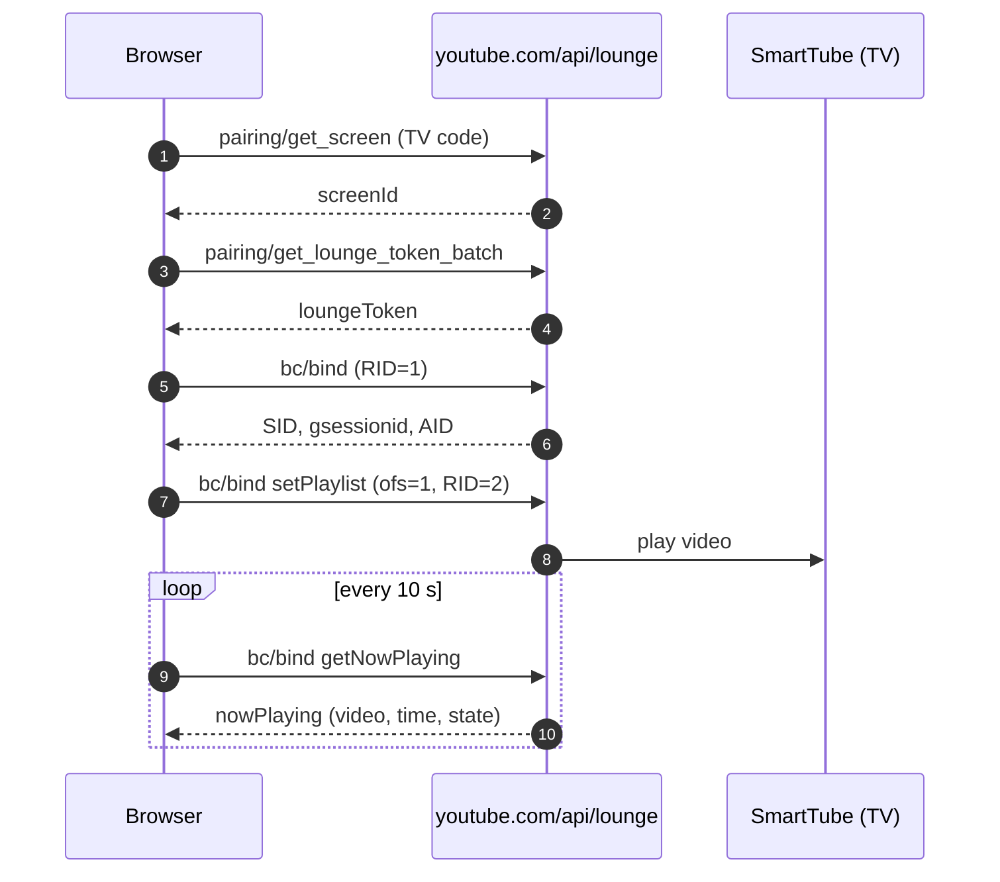

<p align="center">
  
</p>

<h1 align="center">Send to SmartTube</h1>

<p align="center">
  Play the YouTube video you are watching on your TV with <b>SmartTube</b> — one click, no account, no screen mirroring.
</p>

<p align="center">
  
  
  
</p>

<p align="center">
  <a href="README.md">🇬🇧 English</a> ·
  <a href="README.tr.md">🇹🇷 Türkçe</a> ·
  <a href="README.es.md">🇪🇸 Español</a>
</p>

---

A tiny browser extension (and userscript) that sends the current YouTube video to
[SmartTube](https://github.com/yuliskov/SmartTube) on an Android TV. It uses the same mechanism as the
"YouTube → Cast to TV" feature in the mobile app, but it **does not mirror your screen**: the video plays
natively inside SmartTube, ad-free, in its own player.

- **No Google/YouTube account** — both sides can be signed out.
- **No YouTube Premium.**
- **No Cast/Chromecast support needed** — works in browsers like Helium that have no cast support.
- **No third-party servers** — requests go only to `youtube.com`, cookies are never sent.

> Tested with Helium on macOS and a Google TV Streamer running SmartTube.
> This is an unofficial project; it is not affiliated with YouTube, Google or SmartTube.

## Features

- 📺 **Button inside the player** — next to CC / settings / fullscreen, not a floating overlay.
- ▶️ **One click or `Alt + S`** — the video starts on the TV and the local player pauses.
- 🟦 **Cast-style status bar** — thumbnail, title, live state, progress, pause/play, next, stop.
- ♻️ **Survives reloads** — the bar comes back after a page refresh or a browser restart.
- 🌍 **Turkish / English / Spanish UI**, picked automatically from your system language.
- 🔒 **Privacy first** — no analytics, no tracking, no cookies, minimal permissions.

## Install

### Option A — Extension (recommended, lowest memory)

1. Download this repository (**Code → Download ZIP**) and extract it.
2. Open `chrome://extensions` and turn on **Developer mode**.
3. Click **Load unpacked** and select the `extension` folder.
4. Open any YouTube video — the 📺 button appears in the player's control bar.

To update later: replace the files, then press the **Reload** icon on the extension card.

> Chrome may ask about developer-mode extensions at startup. Keep it enabled; the extension is unpacked
> locally and needs no store.

### Option B — Userscript (Tampermonkey / Violentmonkey)

1. Install [Tampermonkey](https://www.tampermonkey.net/) or Violentmonkey.
2. Open the dashboard → **+** → replace the template with the contents of `smarttube-sender.user.js` → save.
3. Open a YouTube video.

> Do not run both versions at the same time — you would get two buttons.

## Pair once

1. Open **SmartTube** on the TV.
2. Go to **Settings → Remote control → Add device** and note the code on screen.
   - Make sure the **Remote control** switch is on.
   - On Android 10+ the app may ask for overlay permission — grant it.
3. Click 📺 in the browser, type the code, press **Connect**.

The code is stored locally and is only asked once.

## Usage

| Action | How |
| --- | --- |
| Send the video to the TV | Click 📺 in the player, or press `Alt + S` |
| Pause / resume on the TV | ⏸ / ▶ in the cast bar |
| Next video on the TV | ⏭ in the cast bar |
| Stop casting | ✕ in the cast bar |
| Reset pairing | Right-click the 📺 button |

When a video is already playing on the TV, clicking 📺 again does **not** restart it — you get a short notice.
Sending a different video reuses the same TV session, so no ghost devices pile up in SmartTube.

The status bar restores itself after a reload by quietly reconnecting to the TV and asking what is
actually playing; if the TV is off, the stale record is discarded.

## How it works



The TV code is exchanged for a screen id, then for a short-lived lounge token. From there it is the same
protocol the mobile app uses. Responses are length-prefixed chunks and are parsed byte-wise (UTF-8 safe).

## Settings

Edit the `OPTIONS` block at the top of `smarttube-sender.user.js`, then rebuild the extension
(`./scripts/build-extension.sh`).

| Option | Default | Meaning |
| --- | --- | --- |
| `pauseLocalAfterSend` | `true` | Pause the browser video after a successful send |
| `showCastBar` | `true` | Show the bottom status bar |
| `castPollMs` | `10000` | How often to refresh the TV state (ms); `0` disables it |
| `restoreCastOnLoad` | `true` | Restore the cast bar when the page loads |

## Languages

The extension (name, description and in-page UI) picks the language from your **system/browser language**:
Turkish, Spanish, otherwise English. On GitHub, README files cannot auto-switch — use the links at the top.
The optional landing page in [`index.html`](index.html) (GitHub Pages) does detect the language automatically.

## Privacy

- All requests go to `https://www.youtube.com/api/lounge/...` with `credentials: 'omit'`.
- Only two keys are stored in `localStorage`:
  `smarttube-sender:screen-id` (TV identity) and `smarttube-sender:cast` (last cast, used to restore the bar).
- Requested permissions: `https://www.youtube.com/*` only. No analytics, no remote code, no telemetry.

## Troubleshooting

| Symptom | Fix |
| --- | --- |
| The button is missing | It only appears on video pages (`/watch`, `/shorts`, `/live`). Reload and check that the extension is enabled. |
| The button sits in the corner instead of the control bar | The player controls were not ready; it moves into place within a second. |
| "Invalid or expired TV code" | The code is short-lived — get a fresh one in SmartTube → Settings → Remote control. |
| "SmartTube is not open on the TV" | Open the SmartTube app; keep Remote control enabled and allow background/overlay permission. |
| "Could not create a session with the TV" | Bring SmartTube to the foreground and try again (the app was probably killed in the background). |
| "Pairing expired" | The token was revoked; press the button and enter a new TV code (it asks automatically). |
| No cast bar | It only appears after a successful send; check `showCastBar`. |
| The bar says "playing" but the TV is paused | The state refreshes every 10 s; some SmartTube builds do not support `getNowPlaying`, in which case the state stays optimistic. |
| The bar did not come back after a reload | The TV was probably off (the record is discarded) or `restoreCastOnLoad` is disabled. |
| Local video keeps playing | `pauseLocalAfterSend` is disabled. |

If the unofficial Lounge API changes, the extension may stop working. A reliable local fallback is sending
the URL over ADB: SmartTube handles `youtu.be` links natively.

## Development

```bash
node test/lounge.test.cjs        # pure helpers: 25 tests
node test/extension.test.cjs     # extension package consistency: 12 tests

./scripts/build-extension.sh     # regenerate extension/content.js + icons
./scripts/package.sh             # build dist/smarttube-tv-sender-vX.Y.Z.zip

# end-to-end UI test with a fake TV (no real TV needed)
python3 -m http.server 8931 --bind 127.0.0.1
# then open http://127.0.0.1:8931/test/harness.html
```

`extension/content.js` is **generated** from `smarttube-sender.user.js`; the test suite fails if the two
drift apart. The harness stubs `fetch`, checks the pairing flow, control-bar placement, local pause,
cast controls, session reuse, reload/restore and error paths, and runs under YouTube's Trusted Types CSP.

### Project structure

```
extension/                 Chrome/Chromium extension (Manifest V3)
  _locales/{en,tr,es}/     extension name + description per language
  icons/                   generated PNG icons
  content.js               generated from smarttube-sender.user.js
smarttube-sender.user.js   source of truth (also usable as a userscript)
scripts/                   build, package, backup, restore, icon generator
test/                      unit tests + fake-TV harness
index.html                 optional GitHub Pages landing page (auto language)
backups/                   versioned snapshots + SHA256SUMS
```

## License

[MIT](LICENSE) © Cihangir Kavcı (chngrkvc)

Not affiliated with YouTube, Google or SmartTube. YouTube and SmartTube are trademarks of their
respective owners. Use at your own risk.
