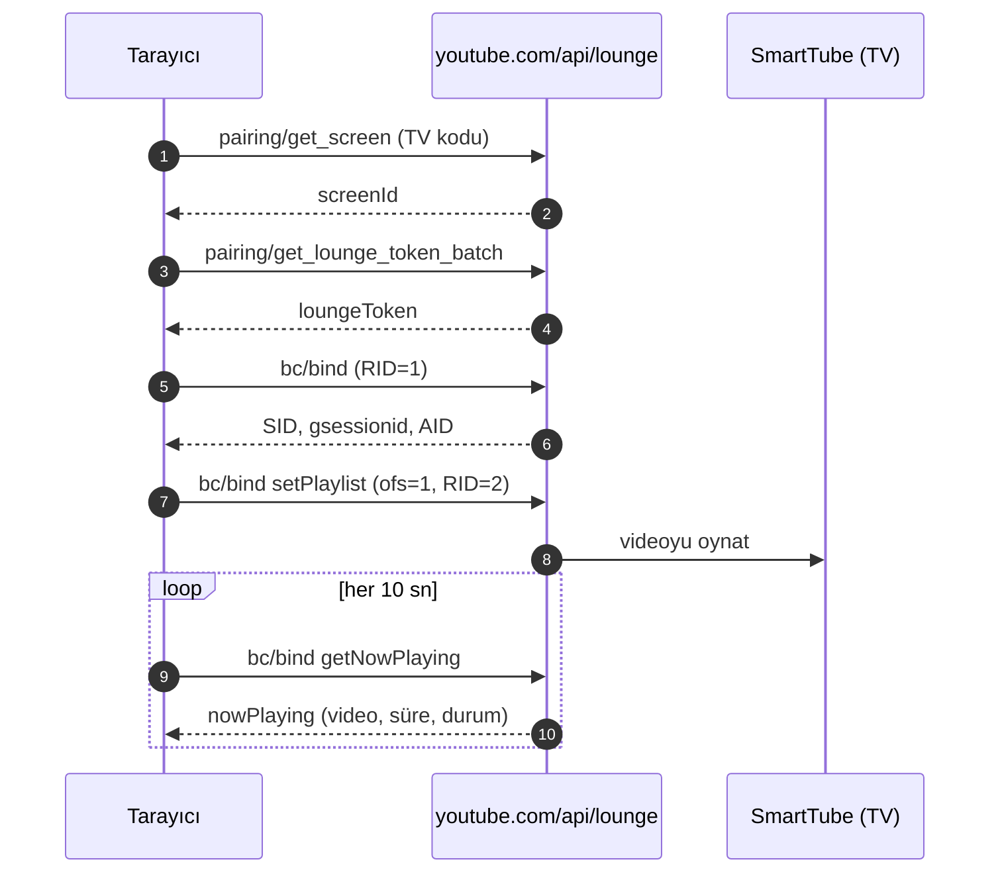

<p align="center">
  
</p>

<h1 align="center">SmartTube TV'ye Gönder</h1>

<p align="center">
  İzlediğin YouTube videosunu tek tıkla TV'de <b>SmartTube</b> ile oynat — hesap yok, ekran yansıtma yok.
</p>

<p align="center">
  
  
  
</p>

<p align="center">
  <a href="README.md">🇬🇧 English</a> ·
  <a href="README.tr.md">🇹🇷 Türkçe</a> ·
  <a href="README.es.md">🇪🇸 Español</a>
</p>

---

İzlediğin YouTube videosunu Android TV'deki [SmartTube](https://github.com/yuliskov/SmartTube) uygulamasında
açan küçük bir tarayıcı eklentisi (ve userscript). Telefon uygulamasındaki "YouTube → TV'ye gönder" ile aynı
mekanizmayı kullanır ama **ekranı yansıtmaz**: video TV'de kendi oynatıcısında, reklamsız, native olarak oynar.

- **Google/YouTube hesabı gerekmez** — iki tarafta da çıkış yapmış olabilirsin.
- **YouTube Premium gerekmez.**
- **Cast/Chromecast desteği gerekmez** — Helium gibi cast desteği olmayan tarayıcılarda çalışır.
- **3. taraf sunucu yok** — istekler yalnızca `youtube.com`'a gider, çerez gönderilmez.

> macOS'ta Helium ve SmartTube çalışan bir Google TV Streamer ile test edildi.
> Bu resmî olmayan bir projedir; YouTube, Google veya SmartTube ile bağlantılı değildir.

## Özellikler

- 📺 **Düğme oynatıcının içinde** — CC / ayarlar / tam ekran ikonlarının yanında, köşede yüzen bir kutu değil.
- ▶️ **Tek tık veya `Alt + S`** — video TV'de başlar, tarayıcıdaki oynatıcı duraklar.
- 🟦 **Cast tarzı durum çubuğu** — kapak görseli, başlık, canlı durum, ilerleme, duraklat/oynat, sonraki, bitir.
- ♻️ **Yenilemeye dayanıklı** — sayfa yenilenince veya tarayıcı kapanıp açılınca çubuk geri gelir.
- 🌍 **Türkçe / İngilizce / İspanyolca arayüz**, sistem diline göre otomatik seçilir.
- 🔒 **Önce gizlilik** — analitik yok, takip yok, çerez yok, minimum izin.

## Kurulum

### Yol A — Eklenti (önerilen, en az bellek)

1. Bu depoyu indir (**Code → Download ZIP**) ve çıkart.
2. `chrome://extensions` sayfasını aç, sağ üstten **Geliştirici modu**'nu aç.
3. **Paketlenmemiş öğe yükle** → `extension` klasörünü seç.
4. Herhangi bir YouTube videosu aç — 📺 düğmesi oynatıcının kontrol çubuğunda görünür.

Güncelleme: dosyaları değiştir, sonra eklenti kartındaki **Yenile** simgesine bas.

> Chrome açılışta geliştirici modu uyarısı gösterebilir. Açık bırak; eklenti yereldir, mağaza gerekmez.

### Yol B — Userscript (Tampermonkey / Violentmonkey)

1. [Tampermonkey](https://www.tampermonkey.net/) veya Violentmonkey kur.
2. Paneli aç → **+** → şablonu sil, `smarttube-sender.user.js` içeriğini yapıştır → kaydet.
3. Bir YouTube videosu aç.

> İki sürümü aynı anda çalıştırma — iki düğme görünür.

## Bir kez eşleştir

1. TV'de **SmartTube**'u aç.
2. **Ayarlar → Remote control → Add device** (Cihaz ekle) → ekrandaki kodu not al.
   - **Remote control** anahtarının açık olduğundan emin ol.
   - Android 10+ cihazlarda uygulama ekran üstü izni isteyebilir; izni ver.
3. Tarayıcıda 📺 düğmesine bas, kodu yaz, **Bağlan**.

Kod yerel olarak saklanır ve yalnızca bir kez sorulur.

## Kullanım

| İşlem | Nasıl |
| --- | --- |
| Videoyu TV'ye gönder | Oynatıcıdaki 📺 düğmesi veya `Alt + S` |
| TV'de duraklat / devam et | Yayın çubuğundaki ⏸ / ▶ |
| TV'de sonraki video | Yayın çubuğundaki ⏭ |
| Yayını bitir | Yayın çubuğundaki ✕ |
| Eşleştirmeyi sıfırla | 📺 düğmesine sağ tık |

Video TV'de zaten oynuyorsa 📺'ye tekrar basmak videoyu **baştan başlatmaz**, kısa bir uyarı verir.
Farklı bir video gönderirken aynı TV oturumu yeniden kullanılır; SmartTube'da hayalet cihazlar birikmez.

Durum çubuğu sayfa yenilenince kendini geri getirir: TV'ye sessizce yeniden bağlanıp gerçekte ne oynadığını
sorar; TV kapalıysa bayat kayıt silinir.

## Nasıl çalışır



TV kodu önce ekran kimliğine, sonra kısa ömürlü bir lounge token'ına çevrilir. Gerisi telefon
uygulamasının kullandığı protokolün aynısıdır. Yanıtlar uzunluk-önekli parçalar hâlindedir ve bayt bazında
(UTF-8 güvenli) ayrıştırılır.

## Ayarlar

`smarttube-sender.user.js` dosyasının başındaki `OPTIONS` bloğunu düzenle, sonra eklentiyi yeniden üret
(`./scripts/build-extension.sh`).

| Ayar | Varsayılan | Anlamı |
| --- | --- | --- |
| `pauseLocalAfterSend` | `true` | Başarılı gönderimden sonra tarayıcıdaki videoyu duraklat |
| `showCastBar` | `true` | Alttaki durum çubuğunu göster |
| `castPollMs` | `10000` | TV durumunun tazelenme sıklığı (ms); `0` kapatır |
| `restoreCastOnLoad` | `true` | Sayfa açılışında yayın çubuğunu geri yükle |

## Diller

Eklenti (ad, açıklama ve sayfa içi arayüz) dili **sistem/tarayıcı dilinden** seçer: Türkçe, İspanyolca,
diğer durumlarda İngilizce. GitHub'da README dosyaları otomatik değişmez — üstteki bağlantıları kullan.
İsteğe bağlı [`index.html`](index.html) açılış sayfası (GitHub Pages) dili otomatik algılar.

## Gizlilik

- Tüm istekler `https://www.youtube.com/api/lounge/...` adresine, `credentials: 'omit'` ile gider.
- `localStorage`'da yalnızca iki anahtar tutulur:
  `smarttube-sender:screen-id` (TV kimliği) ve `smarttube-sender:cast` (çubuğu geri getirmek için son yayın).
- İstenen izin yalnızca `https://www.youtube.com/*`. Analitik, uzaktan kod, telemetri yok.

## Sorun giderme

| Belirti | Çözüm |
| --- | --- |
| Düğme görünmüyor | Yalnızca video sayfalarında (`/watch`, `/shorts`, `/live`) çıkar. Sayfayı yenile, eklentinin açık olduğunu kontrol et. |
| Düğme köşede, kontrol çubuğunda değil | Oynatıcı kontrolleri henüz hazır değildi; bir saniye içinde yerine geçer. |
| "TV kodu geçersiz ya da süresi dolmuş" | Kod kısa ömürlüdür — SmartTube → Ayarlar → Remote control'den yenisini al. |
| "TV'de SmartTube açık değil" | SmartTube'u aç; Remote control açık kalsın, arka plan/ekran üstü iznini ver. |
| "TV ile oturum kurulamadı" | SmartTube'u öne getirip tekrar dene (uygulama arka planda kapatılmış olabilir). |
| "Eşleştirme süresi doldu" | Token geçersiz kılınmış; düğmeye bas, yeni TV kodunu gir (otomatik sorulur). |
| Yayın çubuğu yok | Yalnızca başarılı gönderimden sonra çıkar; `showCastBar` açık mı? |
| Çubuk "oynatılıyor" diyor ama TV'de durmuş | Durum 10 sn'de bir tazelenir; bazı SmartTube sürümleri `getNowPlaying`'i desteklemez ve durum tahmini kalır. |
| Yenilemeden sonra çubuk gelmedi | TV kapalı olabilir (kayıt silinir) veya `restoreCastOnLoad` kapalıdır. |
| Tarayıcıdaki video duraklamıyor | `pauseLocalAfterSend` kapalıdır. |

Resmî olmayan Lounge API değişirse eklenti çalışmayabilir. Güvenilir yerel alternatif, bağlantıyı ADB ile
göndermektir: SmartTube `youtu.be` bağlantılarını doğrudan işler.

## Geliştirme

```bash
node test/lounge.test.cjs        # saf yardımcılar: 25 test
node test/extension.test.cjs     # eklenti paketi tutarlılığı: 12 test

./scripts/build-extension.sh     # extension/content.js + ikonları üret
./scripts/package.sh             # dist/smarttube-tv-sender-vX.Y.Z.zip üret

# sahte TV ile uçtan uca test (gerçek TV gerekmez)
python3 -m http.server 8931 --bind 127.0.0.1
# sonra: http://127.0.0.1:8931/test/harness.html
```

`extension/content.js` **üretilir**; `smarttube-sender.user.js` ile arasında kayma olursa testler kırmızıya
döner. Test ortamı `fetch`'i sahteler; eşleştirme, kontrol çubuğuna yerleşim, yerel duraklatma, yayın
kontrolleri, oturum yeniden kullanımı, yenileme/geri yükleme ve hata yollarını YouTube'un Trusted Types
CSP'si altında doğrular.

### Proje yapısı

```
extension/                 Chrome/Chromium eklentisi (Manifest V3)
  _locales/{en,tr,es}/     dile göre eklenti adı + açıklaması
  icons/                   üretilen PNG ikonlar
  content.js               smarttube-sender.user.js'ten üretilir
smarttube-sender.user.js   tek kaynak (userscript olarak da kullanılır)
scripts/                   derleme, paketleme, yedek, geri yükleme, ikon üretici
test/                      birim testleri + sahte TV koşumu
index.html                 isteğe bağlı GitHub Pages açılış sayfası (otomatik dil)
backups/                   sürüm bazlı yedekler + SHA256SUMS
```

## Lisans

[MIT](LICENSE) © Cihangir Kavcı (chngrkvc)

YouTube, Google veya SmartTube ile bağlantılı değildir. YouTube ve SmartTube ilgili sahiplerinin
markalarıdır. Kullanım sorumluluğu kullanıcıya aittir.
